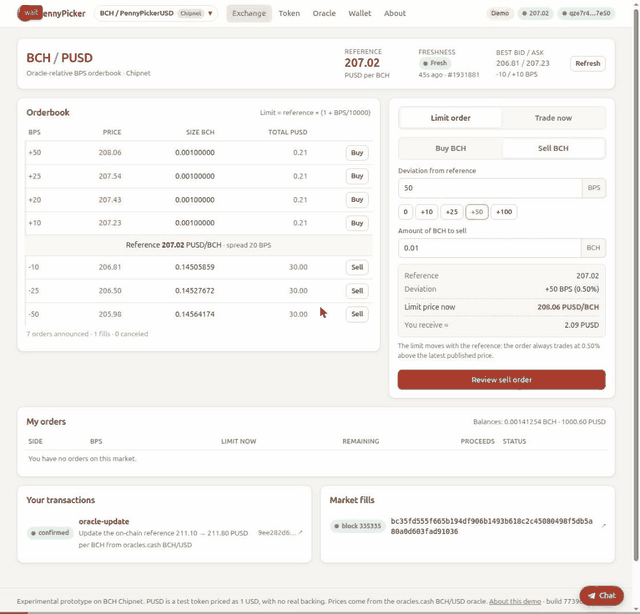

# PennyPicker

*Don't pick up pennies in front of the steamroller.*

**Oracle Delta Basis Points Denominated Orderbook DEX for Stablecoins**, on Bitcoin Cash.

Live demo: **https://pennypicker.pages.dev** (Chipnet with free test coins, plus a live ParyonUSD market on BCH mainnet)

Instead of pricing limit orders at a static dollar price that goes stale every time BCH moves, orders are
denominated in basis points (±bps) relative to the live oracle price.

Because every core mechanism in a stablecoin protocol is ultimately a spread trade against the oracle, an
oracle-delta orderbook doesn't just improve stablecoin trading experience and liquidity — it could also replace
three separate protocol mechanics with a single P2P market:

1. **No more "0% interest PUSD loans" just to swap BCH to PUSD.** Users swap BCH for PUSD directly against resting
   bids anchored tightly around the oracle price (0 bps).
2. **P2P market liquidations (0–10%) instead of a flat 10% penalty.** Bids from 0 to −1000 bps replace the Stability
   Pool; competition drives liquidation penalties down.
3. **Market-based redemptions.** Redemption-eligible loans sit on the orderbook, making redemption pricing 100%
   market-driven instead of hardcoded fees and baseRate decay math.

<p align="center">
  
  <br><sub>A real two-wallet trade on Chipnet: Trader A fills Trader B's +10 BPS ask, and the same transaction pushes the
  latest oracles.cash price on-chain (<a href="https://bchexplorer.cash/chipnet/tx/74966ac56d7fed89db2ff4e21f912f18e83541fdd6ba6efcd55099f341a71de7">74966ac5…</a>).</sub>
</p>

## Try it in 5 minutes (free test coins)

1. **Wallet:** open [Cashonize](https://cashonize.com), create a wallet, and switch it to **Chipnet** in Settings.
2. **Test BCH:** request free Chipnet coins for your address from the [faucet](https://tbch.googol.cash).
3. **Connect:** on https://pennypicker.pages.dev open **Wallet → Connect Cashonize** (WalletConnect), or
   **Connect with WizardConnect** for an HD wallet, then scan the QR code or paste the code into the wallet.
4. **Trade:** on the Exchange, choose **Trade now → Sell BCH 0.001** to sell into a resting bid and receive test PPUSD.
   Or place a **Limit order** at ±BPS from the oracle price.

The Chipnet book is seeded with small asks at +20/+25/+50 BPS and 30 PPUSD bids at −10/−25/−50 BPS. Every transaction is previewed,
signed in the wallet and broadcast only when you press Broadcast.

## How it works

- **Orders are covenants.** Each limit order is its own P2SH32 CashScript contract (`PennyPickerOrder`) holding the
  escrow: asks escrow BCH, bids escrow the stablecoin. Its limit is `reference × (10000 + bps) / 10000`, so it
  re-prices automatically whenever the reference moves.
- **Exact settlement.** `fill()` enforces `dUnits·1e18 + dSat·price·(10000 + bps) ≥ 0` with integer arithmetic;
  the app rounds in the maker's favour.
- **Real oracle.** The reference is the BCH/USD price signed by the General Protocols oracle behind
  [oracles.cash](https://oracles.cash) (the same oracle ParyonUSD uses). `PennyPickerOracle.update()` verifies the
  signed message with `OP_CHECKDATASIG` and only accepts newer messages, so anyone can update it and old prices can
  never be replayed against resting orders. Orders and fills carry the newest message and update the price in the
  same transaction.
- **Wallet.** [Cashonize](https://cashonize.com) over WalletConnect, or any HD wallet over
  [WizardConnect](https://wizardconnect-456f57.gitlab.io). For HD wallets the app scans every shared path (receive,
  change) with the BIP44 gap limit, shows the balance of all used addresses, funds trades from any of them and asks
  the wallet to sign each input with its own path; change, proceeds and the maker key of new orders use the wallet's
  first receive address. Every transaction is previewed, signed in the wallet, checked against the preview and only
  then broadcast.
- **Live data, only when it is shown.** While the Exchange (or the Oracle page) is open in a visible tab, the app
  checks the market every 5 s with one cheap Electrum request and reloads the book when something changed; the
  oracles.cash price refreshes every 20 s. Hidden tabs and other pages do not poll the book.

Contracts: [`packages/app/src/lib/pennypicker/contracts`](packages/app/src/lib/pennypicker/contracts) ·
Transaction builders: [`exchange.ts`](packages/app/src/lib/pennypicker/exchange.ts) ·
Status, live Chipnet transactions and design notes: [`PROJECT_STATUS.md`](PROJECT_STATUS.md) ·
Security review: [`SECURITY_REVIEW.md`](SECURITY_REVIEW.md) ·
Hackathon submission: [`SUBMISSION.md`](SUBMISSION.md) · Demo script: [`DEMO_SCRIPT.md`](DEMO_SCRIPT.md) · Status report and plan: [`REPORT.md`](REPORT.md)

## Status

Experimental hackathon prototype. Two markets:

- **PennyPickerUSD (PPUSD) on Chipnet, tradable.** A fixed-supply test token priced as 1 USD, with no backing.
- **ParyonUSD (PUSD) on BCH mainnet, live (real money, 25 PUSD cap per order).** The app supports mainnet end to end:
  addresses, Cashonize chain and Electrum. The mainnet price record and a real order, fill and cancel are listed in
  `SUBMISSION.md`. There is no price keeper yet, so keep mainnet orders small and short-lived.

The contracts have had an internal security review only, no independent audit.

Real two-wallet trades, fills in both directions, cancels and oracle updates have been signed in Cashonize and
confirmed on Chipnet; the transaction IDs are listed in `PROJECT_STATUS.md`.

## Run locally

```bash
pnpm install
cp packages/app/.env.example packages/app/.env   # add a WalletConnect (Reown) project ID
pnpm --filter app dev                            # http://localhost:5173
```

Tests (BCH 2025 VM via Libauth), from `packages/app`:

```bash
pnpm dlx tsx scripts/pennypicker-contracts.test.ts   # covenant checks, incl. a real oracles.cash message
pnpm dlx tsx scripts/pennypicker-exchange.test.ts    # transaction builders, signed and VM-verified
pnpm dlx tsx scripts/pennypicker-identity.test.ts
pnpm dlx tsx scripts/pennypicker-wizardconnect.test.ts # HD address scan, per-input signing paths
pnpm dlx tsx scripts/pennypicker-mainnet-check.ts      # read-only: reaches mainnet, finds ParyonUSD
```

## Credits

This project was forked from [Vox](https://github.com/2qx/vox), an open-source collection of Bitcoin Cash apps by
2qx. It builds on [CashScript](https://cashscript.org), [Libauth](https://libauth.org), Cashonize and the General
Protocols oracles. Licensed under the terms in [LICENSE](LICENSE).
